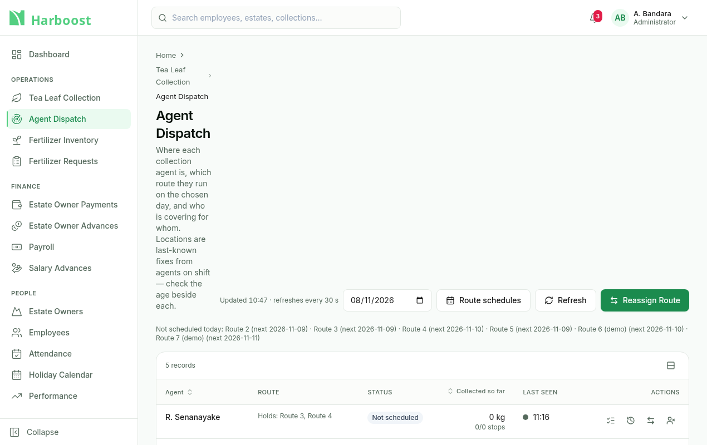
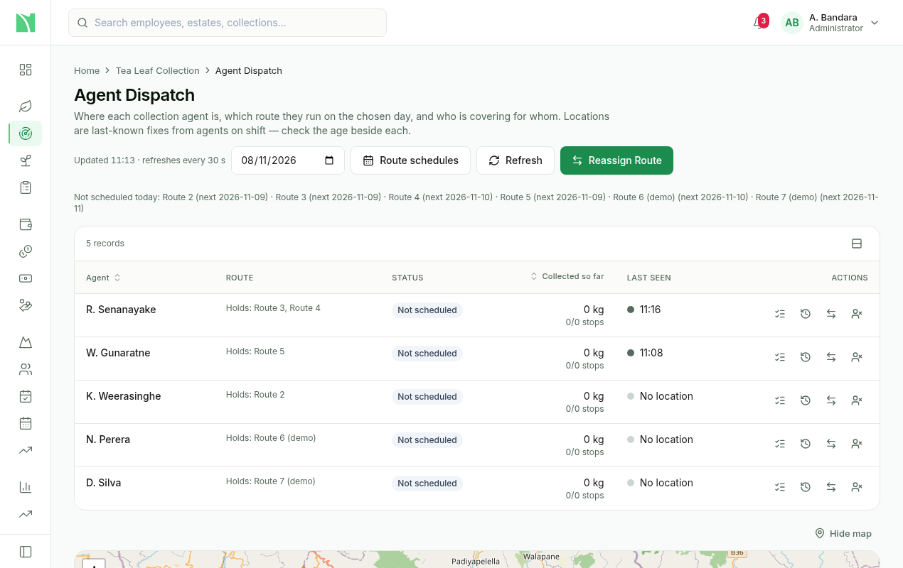

# Page layout: headers, wide boards and the sidebar (Addendum)

Status: implemented on `feat/fertilizer-alerts-cards-layout` · 2026-11-08

This addendum covers the portal's shared page shell (`AppShell`, `Sidebar`, `PageHeader`) and
the Agent Dispatch board (COL-05). It started from a bug. On a normal laptop window (about
1,270 px), Agent Dispatch's breadcrumb stacked and its title wrapped one word per line.

## 1. Cause

`PageHeader` was a flex row from `sm` up. The title block was `min-w-0` and the actions wrapper
was `shrink-0`, so the actions kept their full one-line width and the title gave way. Dispatch's
toolbar (updated time, a fixed `w-40` date input, Today, Route schedules, Refresh, Reassign
Route) is about 800 px wide. At 1,270 px, the 248 px sidebar and 64 px of padding leave about
958 px of content, so the title got about 140 px.

The map and the table were not the cause. The board was already one column below `2xl`, and
the table scrolls inside its own box.

## 2. Header rule (every page)

`PageHeader` is a wrapping flex row:

- The title block is `flex-[1_1_22rem]`: it starts at 22 rem and grows.
- The actions are `flex-wrap` and never `shrink-0`.

When both fit, the actions sit to the right of the title. When they don't, the actions wrap onto
their own line below it. The breadcrumb, title and description always span the content width.
Because every page uses `PageHeader`, this one change also covers Fertilizer Inventory,
Fertilizer Requests, Performance, Payroll, Attendance and Holiday Calendar.

## 3. Agent Dispatch by width

| Window | Layout |
|---|---|
| ≥ 1,440 px (`wide:`) | Agent table and map side by side (1.4 : 1); the map is sticky |
| < 1,440 px | The map stacks under the table, full width: 360 px high, 420 px from 1,280 px. **Show map / Hide map** toggles it. |
| < 768 px (`md`) | The table becomes a card list (agent, route, status, last seen, an actions menu). The cards reuse the table's own cell renderers, and the row actions come from one `actionsFor()` list. |

- Below its minimum width, the table scrolls horizontally inside its own container, with the
  Agent column sticky. The page itself never scrolls sideways.
- `wide` is a theme breakpoint (`--breakpoint-wide: 90rem` in `index.css`).
- The map calls `invalidateSize()` whenever its box changes (toggle, resize), so tiles never
  render half-grey.

## 3.1 Tables never widen the page

`DataTable`'s horizontal scroll box is `relative`. Without it, absolutely positioned cell content,
such as the `sr-only` screen-reader text beside icons, was placed against an ancestor outside the
scroll box. It escaped the clip and widened the whole page. The Playwright run found this on
Performance at 768 px, where the page was 989 px wide. The fix is in the shared component, so
it covers every table.

## 4. Sidebar

- Below 1,280 px it starts **collapsed to icons**; from 1,280 px it starts expanded.
- The user can always toggle it. The choice is remembered **per user and per width mode**
  (`harboost.sidebar.collapsed.<userId>.<narrow|wide>`), so expanding it on a laptop doesn't
  force it open on a wide monitor.
- It lives in browser storage (there is no server-side preference store yet), so it is per
  device. The old global key `harboost.sidebar.collapsed` is no longer read.
- The main content padding steps down on small screens (`px-4`, `sm:px-6`, `lg:px-8`).

## 5. Checking it

Playwright (Chromium only) lives in `source-code/admin/e2e/`. Start the backend against the local
DB first. The portal is served on its own port (5199):

```
cd source-code/admin
E2E_API_URL=http://localhost:3001 E2E_USER=<admin phone> E2E_PASS=<password> npx playwright test layout
SCREENSHOTS=1 E2E_API_URL=… E2E_USER=… E2E_PASS=… npx playwright test screenshots
```

- **`layout.spec.ts`** checks the 7 pages at 1,920 / 1,440 / 1,366 / 1,280 / 1,024 / 768 px and at
  90% / 110% zoom on a 1,280 px window:
  - the title is one line and the breadcrumb doesn't stack (from 1,024 px);
  - the page never scrolls sideways.

  For Dispatch it also checks:
  - the map is beside the table at 1,440 px, below it (and toggleable) at 1,280 px;
  - the card list appears under 768 px.

  It also checks the sidebar default and that the choice is remembered.
- Zoom is emulated the way a browser does it: a viewport of `width / zoom` at a device pixel
  ratio of `zoom`.
- **`screenshots.spec.ts`** writes to `e2e/screenshots/`, which is git-ignored. Only the Dispatch
  before/after pair is kept, in `docs/screenshots/`.
- `E2E_APP_DIR` serves another checkout, such as a worktree of an earlier commit, for "before"
  shots.
- The specs wait for the page's loading spinners to clear, never for `networkidle`. The Dispatch
  board polls every 30 s and the map streams tiles, so the network is never idle.
- Result on 2026-11-08: all 60 checks pass against the local DB.



